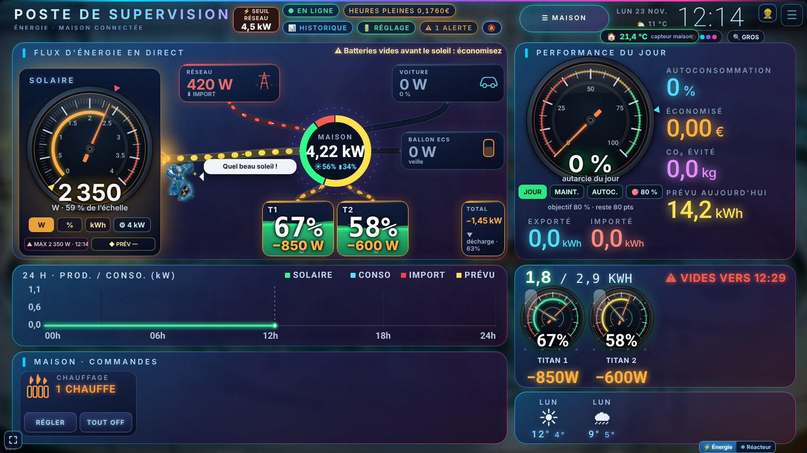

# ⚡ Énergie Réacteur — carte Home Assistant pour batteries Izypower Titan

[](https://hacs.xyz)
[](https://github.com/Biwaire/energie-card/releases)

Un tableau de bord énergie complet, en **une seule carte** : production solaire, réseau, batteries **Izypower Titan**, voiture électrique, ballon d'eau chaude, prévisions Solcast, météo, historique, scénarios… et **Watt** 👷, l'assistant qui commente votre maison.

Deux vues au choix : **⚡ Énergie** (poste de supervision) et **⚛ Réacteur** (salle des machines animée).




---

## Installation

### Avec HACS (recommandé)

1. Ouvrez **HACS** dans Home Assistant.
2. Menu **⋮** (en haut à droite) › **Dépôts personnalisés**.
3. Collez `https://github.com/Biwaire/energie-card`, choisissez le type **Tableau de bord** (*Dashboard*), puis **Ajouter**.
4. Cherchez **Énergie Réacteur**, ouvrez-la, puis **Télécharger**.
5. Rechargez la page du navigateur (Ctrl + F5 sur ordinateur).

HACS ajoute tout seul la ressource. Les mises à jour arriveront ensuite dans HACS comme pour les autres cartes.

### Installation manuelle

1. Téléchargez `energie-card.js` depuis la [dernière version](https://github.com/Biwaire/energie-card/releases).
2. Copiez-le dans `/config/www/`.
3. **Paramètres › Tableaux de bord › ⋮ › Ressources › Ajouter** : URL `/local/energie-card.js?v=1`, type **Module JavaScript**.
4. Rechargez la page. Après chaque mise à jour, passez à `?v=2`, `?v=3`…

## Ajouter la carte

1. Ouvrez un tableau de bord › **Modifier** › **Ajouter une carte**.
2. Cherchez **Énergie Réacteur** et ajoutez-la.

> 💡 Conseil : créez une vue dédiée en mode **Panneau** (une seule carte, pleine page). C'est là que la carte est la plus belle.

## Réglages : rien à écrire

La carte **trouve seule vos capteurs** : solaire, réseau, batteries Izypower, borne de recharge, ballon, Solcast, météo, température de la maison.

Si un capteur est mal détecté, ouvrez la carte en modification : l'**éditeur visuel** permet de choisir le bon dans une liste. Les rubriques :

| Rubrique | Ce qu'on y règle |
|---|---|
| Capteurs principaux | solaire, réseau, borne voiture, niveau et autonomie voiture, ballon ECS |
| Météo, température, prévisions | entité météo, température de la maison, Solcast aujourd'hui / demain |
| Batteries | jusqu'à 4 batteries : nom, niveau, puissance, température, réglages mini / maxi |
| Éléments affichés | voiture, ballon, chauffage, volets, portail, garage, rappels, Watt… |
| Tarifs et heures creuses | prix HP / HC, plages d'heures creuses |
| Tuile chauffe-eau | sondes haute / basse, grande chauffe, désinfection |
| Avancé | puissance crête, capacité voiture, assistant de conversation pour Watt, adaptation à la hauteur de l'écran, taille de la carte |

Un champ laissé vide = détection automatique.

<details>
<summary><b>Toutes les options YAML</b> (pour les utilisateurs avancés)</summary>

```yaml
type: custom:energie-card
entities:                 # '' ou absent = détection automatique
  pv: sensor.puissance_solaire        # W
  grid: sensor.puissance_reseau       # W, positif = soutirage
  ev: sensor.borne_puissance          # W
  evSoc: sensor.voiture_batterie      # %
  evRange: sensor.voiture_autonomie   # km
  evLid: binary_sensor.trappe_charge
  ecs: sensor.ballon_puissance        # W
  ecsTotal: sensor.ballon_energie     # kWh
weather: weather.maison
house_temp: sensor.temperature_salon
solcast:
  today: sensor.solcast_aujourd_hui
  tomorrow: sensor.solcast_demain
batteries:                # 4 maximum
  - name: Titan
    level: sensor.titan_pile_average            # %
    power: sensor.titan_ac_input_and_output     # W
    temperature: sensor.titan_battery_temperature
    min: number.titan_soc_mini                  # réglage du mini
    max: number.titan_soc_maxi                  # réglage du maxi
    invert: false                               # charge/décharge à l'envers
packs: [1, 1]             # packs par batterie
kwh_pack: 4.02            # capacité d'un pack (kWh)
invert_bat: false
modules:                  # valeurs par défaut ci-dessous
  voiture: true
  ballon: true
  chauffeeau: true
  chauffage: true
  scenarios: true
  volets: false
  portail: false
  garage: false
  rappels: false
  watt: true
ecs_tile:
  haute: sensor.ballon_sonde_haute
  basse: sensor.ballon_sonde_basse
  grande: switch.ballon_grande_chauffe
  desinf: sensor.ballon_derniere_desinfection
tarif_hp: 0.176           # €/kWh
tarif_hc: 0.1361          # €/kWh
hc_plages:
  - ["22:00", "06:00"]
pv_max: 4000              # W crête
invert_grid: false
co2_kg_kwh: 0.052
ev_kwh: 60                # capacité utile voiture
ev_target: 80             # % visé
agent: conversation.google_generative_ai   # '' = assistant par défaut
fit_screen: true          # la carte tient dans la hauteur de l'écran (false = pleine largeur, défilement)
aspect_ratio: 16/9        # ou 56% (comme l'ancienne iframe)
height: calc(100vh - 56px)  # hauteur fixe (prioritaire)
```

Un exemple réel complet se trouve dans [`examples/config-biwaire.yaml`](examples/config-biwaire.yaml).
</details>

## Watt 👷 et l'assistant IA

Watt répond tout seul aux questions courantes (autonomie, économies, « puis-je lancer un appareil ? »…).
Pour les questions libres, il utilise l'assistant de conversation de Home Assistant (**Paramètres › Assistants vocaux**). Avec Google Gemini ou OpenAI configuré, choisissez-le dans **Avancé › Assistant de conversation**.

## Vous utilisiez la version iframe (`energie.html`) ?

1. Installez la carte (voir plus haut).
2. Remplacez la carte `iframe` par `type: custom:energie-card`.
3. Reportez vos anciens réglages (capteurs, batteries, tarifs) dans l'éditeur visuel.

Vos réglages enregistrés dans le navigateur (thème, rappels, seuils, Watt) sont conservés.

## Questions fréquentes

- **La carte n'apparaît pas / « Custom element doesn't exist »** : videz le cache du navigateur (Ctrl + F5). Dans l'application mobile : Paramètres › Compagnon › Débogage › Réinitialiser le cache du frontend.
- **Une batterie affiche « -- »** : vérifiez ses capteurs dans la rubrique Batteries. Le bouton **Statut** de la vue Réacteur liste les capteurs hors ligne.
- **L'historique 7 / 30 jours est vide** : vos capteurs de puissance doivent avoir des statistiques long terme (`state_class: measurement`).
- **Charge et décharge sont inversées** : cochez « Charge/décharge inversée » pour la batterie concernée.

## Crédits

- Tableau de bord d'origine : **[tazzdel](https://github.com/tazzdel)** — [ha-energie-dashboard-v2](https://github.com/tazzdel/ha-energie-dashboard-v2), conçu pour les batteries Zendure.
- Photo de fond de la vue Réacteur : **tazzdel**, diffusée avec son accord.
- Adaptation aux batteries **Izypower Titan** et version carte : **Biwaire**, avec l'accord écrit de l'auteur original.
- Licence MIT, au nom des deux auteurs, choisie avec l'accord de tazzdel.
- Aucune affiliation avec Izypower, Zendure ou Home Assistant.

## Pour les contributeurs

Le tableau de bord se modifie dans `src/energie.html` (fichier unique, comme avant). La carte est générée automatiquement :

```bash
npm run build     # src/energie.html → dist/energie-card.js
```

Committez `src/` **et** `dist/`. Ensuite, publiez une *release* GitHub (ex. `v1.0.1`) : HACS proposera la mise à jour à tout le monde. Pensez à augmenter `version` dans `package.json`.

---

*English: a single-card energy dashboard for Home Assistant (solar, grid, Izypower Titan batteries, EV, water heater, Solcast). Install through HACS as a custom "Dashboard" repository, add `type: custom:energie-card`, and set sensors in the visual editor (auto-detected by default). UI is in French.*
