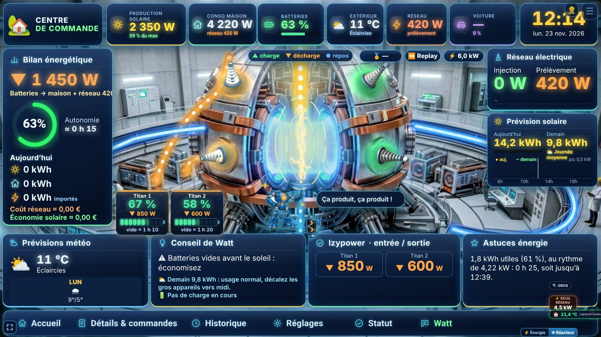
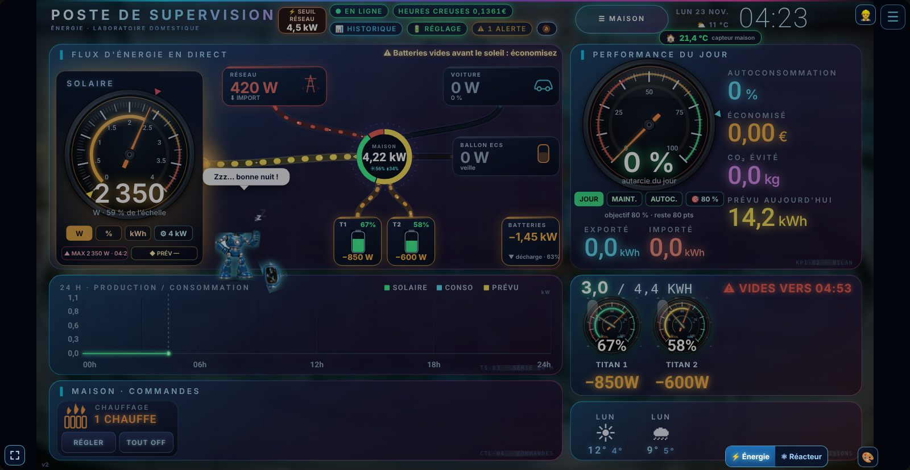
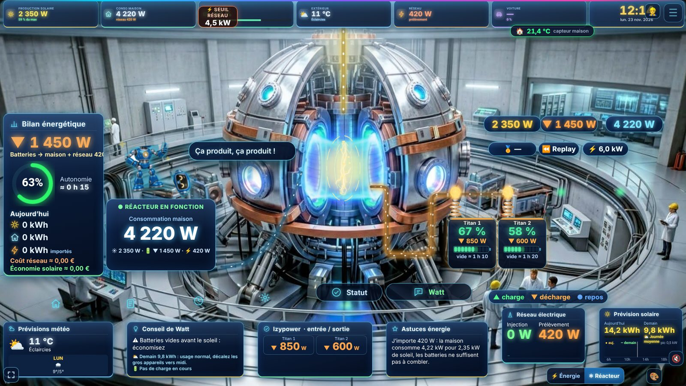

# ⚡ Énergie Réacteur — carte Home Assistant pour batteries Isypower (Izypower) Titan et Zendure

[](https://hacs.xyz)
[](https://github.com/Biwaire/energie-card/releases)

Un tableau de bord énergie complet, en **une seule carte** : production solaire, réseau, batteries **Isypower (ex-Izypower) Titan** ou **Zendure** (SolarFlow, Hyper…), voiture électrique, ballon d'eau chaude, prévisions Solcast, météo, historique, scénarios… et **Watt** 👷, l'assistant qui commente votre maison.

Deux vues au choix : **⚡ Énergie** (poste de supervision) et **⚛ Réacteur** (salle des machines animée).

Et deux **styles** : **Nouveau** (réacteur sombre et net, barre de navigation) ou **Classique** (salle des machines claire, version d'origine). Le choix se fait dans l'éditeur de la carte.

### Style Nouveau (par défaut)



### Style Classique




---

## Installation

### Home Assistant 2026.11 et plus récent : Marketplace (recommandé)

Depuis la version 2026.11, HACS est intégré à Home Assistant sous le nom **Marketplace**. Si vous aviez déjà installé la carte avec HACS, elle a été reprise automatiquement : rien à refaire.

1. **Paramètres › Marketplace** (la première fois, acceptez l'avertissement).
2. Bouton **Ajouter depuis un lien** (*Add from link*) et collez `https://github.com/Biwaire/energie-card`.
   Home Assistant demande d'associer un compte GitHub (un code à saisir sur github.com) : c'est obligatoire pour les dépôts ajoutés à la main, et en lecture seule.
3. Installez **Énergie Réacteur** : la ressource est ajoutée toute seule.
4. Rechargez la page du navigateur (Ctrl + F5 sur ordinateur).

Les mises à jour arrivent ensuite dans le Marketplace, comme pour les autres cartes.

### Avant 2026.11 : avec HACS

1. Ouvrez **HACS** dans Home Assistant.
2. Menu **⋮** (en haut à droite) › **Dépôts personnalisés**.
3. Collez `https://github.com/Biwaire/energie-card`, choisissez le type **Tableau de bord** (*Dashboard*), puis **Ajouter**.
4. Cherchez **Énergie Réacteur**, ouvrez-la, puis **Télécharger**.
5. Rechargez la page du navigateur (Ctrl + F5 sur ordinateur).

### Installation manuelle

1. Téléchargez `energie-card.js` **et** `energie-card-classic.js` (dossier `dist`).
2. Copiez-les tous dans `/config/www/`. Seul `energie-card.js` s'ajoute comme ressource.
3. **Paramètres › Tableaux de bord › ⋮ › Ressources › Ajouter** : URL `/local/energie-card.js?v=1`, type **Module JavaScript**.
4. Rechargez la page. Après chaque mise à jour, passez à `?v=2`, `?v=3`…

## Ajouter la carte

1. Ouvrez un tableau de bord › **Modifier** › **Ajouter une carte**.
2. Cherchez **Énergie Réacteur** et ajoutez-la.

> 💡 Conseil : créez une vue dédiée en mode **Panneau** (une seule carte, pleine page). C'est là que la carte est la plus belle.

## Réglages : rien à écrire

La carte **trouve seule vos capteurs** : solaire, réseau, batteries Isypower/Izypower ou Zendure, borne de recharge, ballon, Solcast, météo, température de la maison.

Si un capteur est mal détecté, ouvrez la carte en modification : l'**éditeur visuel** permet de choisir le bon dans une liste. Les rubriques :

| Rubrique | Ce qu'on y règle |
|---|---|
| Style du tableau de bord | Nouveau (v2.7) ou Classique (v2) |
| Capteurs principaux | solaire, réseau, borne voiture, niveau et autonomie voiture, ballon ECS |
| Météo, température, prévisions | entité météo, température de la maison, Solcast aujourd'hui / demain |
| Batteries | jusqu'à 4 batteries : nom, niveau, puissance, température, **capacité (kWh)**, réglages mini / maxi ; marque affichée (automatique, Isypower, Izypower, Zendure ou sans marque) |
| Éléments affichés | voiture, ballon, chauffage, volets, portail, garage, rappels, Watt… |
| Tarifs et heures creuses | prix HP / HC, plages d'heures creuses |
| Tuile chauffe-eau | sondes haute / basse, grande chauffe, désinfection |
| Avancé | puissance crête, capacité voiture, assistant de conversation pour Watt, adaptation à la hauteur de l'écran, bouton plein écran, taille de la carte |

Un champ laissé vide = détection automatique.

<details>
<summary><b>Toutes les options YAML</b> (pour les utilisateurs avancés)</summary>

```yaml
type: custom:energie-card
style: classic            # Classique (v2) ; absent = Nouveau (v2.7)
entities:                 # '' ou absent = détection automatique
  pv: sensor.puissance_solaire        # W
  grid: sensor.puissance_reseau       # W, positif = soutirage
  ev: sensor.borne_puissance          # W
  evSoc: sensor.voiture_batterie      # %
  evRange: sensor.voiture_autonomie   # km
  evLid: binary_sensor.trappe_charge
  ecs: sensor.ballon_puissance        # W
  ecsTotal: sensor.ballon_energie     # kWh
weather: weather.maison
house_temp: sensor.temperature_salon
solcast:
  today: sensor.solcast_aujourd_hui
  tomorrow: sensor.solcast_demain
batteries:                # 4 maximum
  - name: Titan
    level: sensor.titan_pile_average            # %
    power: sensor.titan_ac_input_and_output     # W
    # ou, si la batterie a deux capteurs (Zendure : charge et décharge séparées) :
    # power_in: sensor.solarflow_output_pack_power   # W entrant (charge)
    # power_out: sensor.solarflow_pack_input_power  # W sortant (décharge)
    temperature: sensor.titan_battery_temperature
    min: number.titan_soc_mini                  # réglage du mini
    max: number.titan_soc_maxi                  # réglage du maxi
    invert: false                               # charge/décharge à l'envers
    capacity: 6.132                             # capacité en kWh (à additionner) : Titan seul 2,1 · Link 2,1 · nouveau Link 4,032 · Zendure AB1000 0,96 · AB2000 1,92
brand: isypower           # marque affichée : isypower, izypower, zendure, none (absent = automatique)
packs: [1, 1]             # packs par batterie
kwh_pack: 2.1             # capacité d'un pack (kWh), pour les batteries sans « capacity » (défaut : 2,1 = Titan seul)
invert_bat: false
modules:                  # valeurs par défaut ci-dessous
  voiture: true
  ballon: true
  chauffeeau: true
  chauffage: true
  scenarios: true
  volets: false
  portail: false
  garage: false
  rappels: false
  watt: true
ecs_tile:
  haute: sensor.ballon_sonde_haute
  basse: sensor.ballon_sonde_basse
  grande: switch.ballon_grande_chauffe
  desinf: sensor.ballon_derniere_desinfection
tarif_hp: 0.176           # €/kWh
tarif_hc: 0.1361          # €/kWh
hc_plages:
  - ["22:00", "06:00"]
pv_max: 4000              # W crête
invert_grid: false
co2_kg_kwh: 0.052
ev_kwh: 60                # capacité utile voiture
ev_target: 80             # % visé
agent: conversation.google_generative_ai   # '' = assistant par défaut
fit_screen: true          # la carte tient dans la hauteur de l'écran (false = pleine largeur, défilement)
fullscreen_button: true   # bouton plein écran ⛶
swipe: true               # changer de vue en glissant le doigt (écran tactile)
fullscreen_landscape: true  # passer en paysage en plein écran (Android)
aspect_ratio: 16/9        # ou 56% (comme l'ancienne iframe)
height: calc(100vh - 56px)  # hauteur fixe (prioritaire)
```

Exemples complets :
- Isypower / Izypower Titan : [`examples/config-biwaire.yaml`](examples/config-biwaire.yaml)
- Zendure (SolarFlow, Hyper…) : [`examples/config-zendure.yaml`](examples/config-zendure.yaml)
</details>

## Changer de vue en glissant (téléphone, tablette)

Sur écran tactile, faites glisser le doigt horizontalement sur le tableau : **vers la gauche** pour la vue Réacteur, **vers la droite** pour revenir à la vue Énergie. Sur ces écrans, le bouton ⚡ Énergie / ⚛ Réacteur est remplacé par deux petits points ● ○ qui indiquent la vue en cours (un appui sur un point change aussi de vue). Sur ordinateur, le bouton reste affiché. Le geste peut être désactivé dans l'éditeur (rubrique Avancé) ou avec `swipe: false` : le bouton revient alors aussi sur mobile.

## Plein écran

Le bouton **⛶** (en bas à gauche) met la carte en plein écran ; un nouvel appui revient à l'affichage normal.
- **Android (navigateur) et ordinateur** : vrai plein écran, sans les barres, et passage en paysage quand c'est possible.
- **iPhone**, ou si l'application refuse le vrai plein écran : la carte couvre tout l'écran de l'application.

En vue Réacteur, un double-clic sur l'horloge met aussi en plein écran.

## Boutons déplaçables

Les boutons **⚡ Énergie / ⚛ Réacteur**, **🎨** et **⛶** se déplacent : appuyez dessus et faites-les glisser où vous voulez. Un simple appui garde leur action habituelle. La position est mémorisée sur chaque appareil, séparément pour le téléphone en portrait et pour les écrans larges.

## Watt 👷 et l'assistant IA

Watt répond tout seul aux questions courantes (autonomie, économies, « puis-je lancer un appareil ? »…).
Pour les questions libres, il utilise l'assistant de conversation de Home Assistant (**Paramètres › Assistants vocaux**). Avec Google Gemini ou OpenAI configuré, choisissez-le dans **Avancé › Assistant de conversation**.

## Vous utilisiez la version iframe (`energie.html`) ?

1. Installez la carte (voir plus haut).
2. Remplacez la carte `iframe` par `type: custom:energie-card`.
3. Reportez vos anciens réglages (capteurs, batteries, tarifs) dans l'éditeur visuel.

Vos réglages enregistrés dans le navigateur (thème, rappels, seuils, Watt) sont conservés.

## Questions fréquentes

- **Le stock en kWh est faux** : indiquez la **Capacité (kWh)** de chaque batterie dans la rubrique Batteries, en additionnant ses éléments : Isypower/Izypower Titan seul 2,1 · Link 2,1 · nouveau Link 4,032 ; Zendure AB1000 0,96 · AB2000 1,92. Exemple : Titan + nouveau Link = 6,132.

- **La carte n'apparaît pas / « Custom element doesn't exist »** : videz le cache du navigateur (Ctrl + F5). Dans l'application mobile : Paramètres › Compagnon › Débogage › Réinitialiser le cache du frontend.
- **Une batterie affiche « -- »** : vérifiez ses capteurs dans la rubrique Batteries. Le bouton **Statut** de la vue Réacteur liste les capteurs hors ligne.
- **L'historique 7 / 30 jours est vide** : vos capteurs de puissance doivent avoir des statistiques long terme (`state_class: measurement`).
- **Charge et décharge sont inversées** : cochez « Charge/décharge inversée » pour la batterie concernée.
- **Zendure : la puissance batterie est fausse** : beaucoup d'appareils Zendure donnent deux capteurs, un pour la charge (`output_pack_power`) et un pour la décharge (`pack_input_power`). Renseignez-les dans « Puissance entrée » et « Puissance sortie » de la batterie (la carte les détecte normalement toute seule).
- **Le processeur travaille beaucoup quand la carte est affichée** : c'est normal, ce sont les animations (réacteur, flux, halos lumineux), comme avec la version HTML d'origine. La carte se met en pause toute seule dès qu'elle n'est plus visible (autre onglet, autre page, fenêtre réduite) : le processeur retombe alors presque à zéro.

## Crédits

- Tableau de bord d'origine : **[tazzdel](https://github.com/tazzdel)** — [ha-energie-dashboard-v2](https://github.com/tazzdel/ha-energie-dashboard-v2), conçu pour les batteries Zendure.
- Photo de fond de la vue Réacteur : **tazzdel**, diffusée avec son accord.
- Adaptation aux batteries **Izypower Titan** et version carte : **Biwaire**, avec l'accord écrit de l'auteur original.
- Licence MIT, au nom des deux auteurs, choisie avec l'accord de tazzdel.
- Compatibilité Zendure vérifiée par tazzdel sur son installation.
- Aucune affiliation avec Isypower (Izypower), Zendure ou Home Assistant.

## Pour les contributeurs

Les tableaux de bord se modifient en HTML, comme avant :
- `src/energie.html` : style **Nouveau** → `dist/energie-card.js` (carte principale)
- `src/energie-classic.html` : style **Classique** → `dist/energie-card-classic.js` (chargé seulement si ce style est choisi)

La carte est générée automatiquement :

```bash
npm run build
```

Committez `src/` **et** `dist/`. Ensuite, publiez une *release* GitHub (ex. `v1.0.1`) : le Marketplace (ou HACS) proposera la mise à jour à tout le monde. Pensez à augmenter `version` dans `package.json`.

---

*English: a single-card energy dashboard for Home Assistant (solar, grid, Izypower Titan batteries, EV, water heater, Solcast). Install through Settings › Marketplace › Add from link (Home Assistant 2026.11+) or as a HACS custom "Dashboard" repository, add `type: custom:energie-card`, and set sensors in the visual editor (auto-detected by default). UI is in French.*
